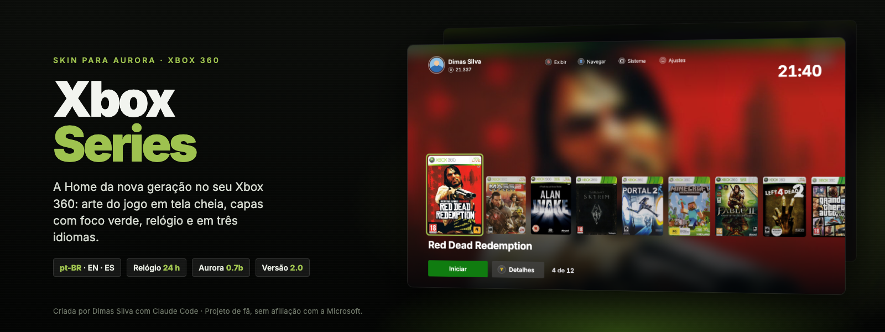
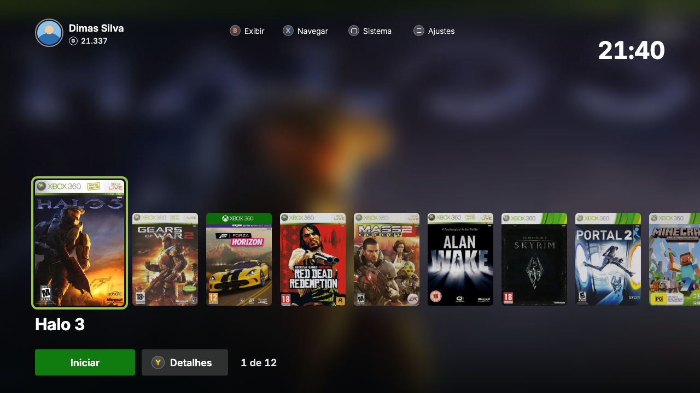
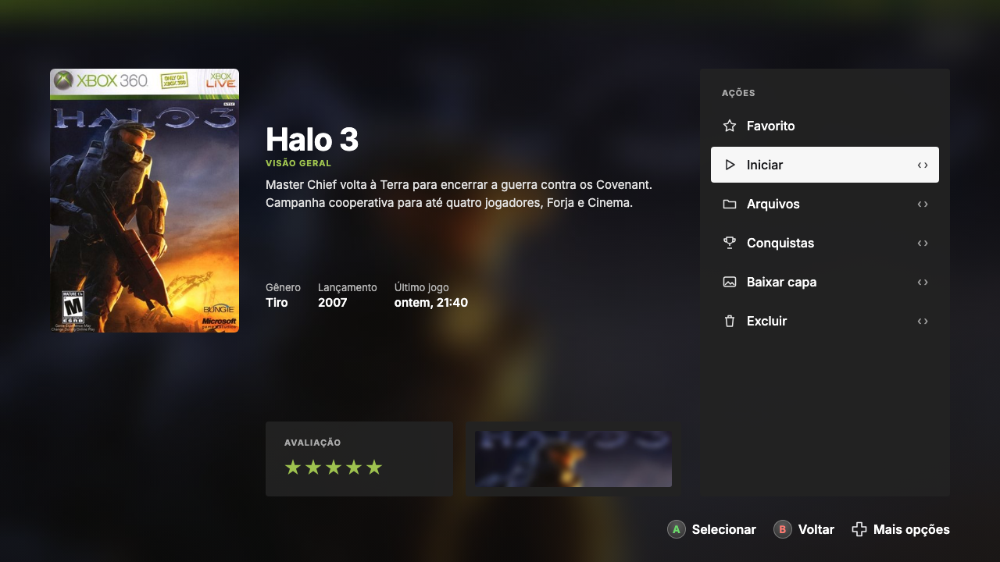
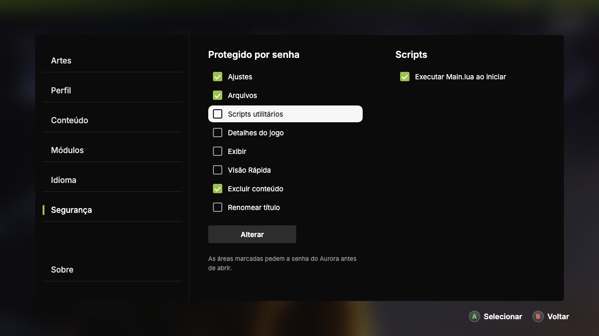
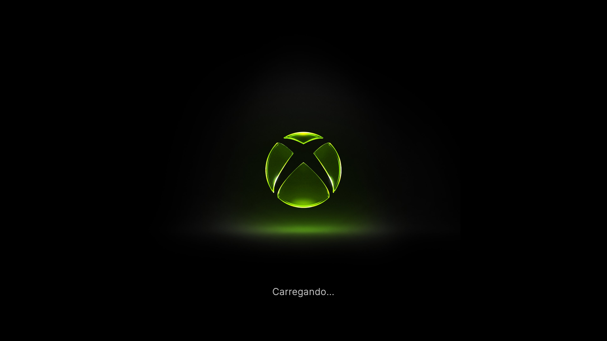

# Xbox Series — Skin para Aurora

> A Home do Xbox Series no seu Xbox 360: arte do jogo em tela cheia e capas com foco verde.

Skin para o dashboard **Aurora** (Xbox 360 desbloqueado), em **português do Brasil**, **inglês** e **espanhol**, com o layout de capas **Xbox Series** que acompanha a skin.

> **English:** Xbox Series–style Home for Aurora 0.7b. Copy the `Aurora` folder to your console, pick the skin **Xbox Series (English)** and the cover layout **Xbox Series**. To show the clock, enable *Settings → Security → Scripts → Run Main.lua on Boot*.
>
> **Español:** Home al estilo Xbox Series para Aurora 0.7b. Copia la carpeta `Aurora` a tu consola, elige la skin **Xbox Series (Español)** y el diseño de portadas **Xbox Series**. Para ver el reloj, activa *Ajustes → Seguridad → Scripts → Ejecutar Main.lua al iniciar*.

Criada por **Dimas Silva** com o **[Claude Code](https://claude.com/claude-code)**, a partir das skins **Liquid Glass** (ammarsi274) e **Clean NXE** (Jayshai). Veja os [créditos](#créditos).



| Início | Detalhes do jogo |
|---|---|
|  |  |
| **Configurações** | **Abertura** |
|  |  |

*Prints da prévia interativa (`tools/xbox-series-preview.html`), que reproduz a skin no navegador; não são fotos do console. As capas são as do XboxUnity, a mesma fonte que o Aurora usa. Os fundos são de exemplo; no console aparece a arte de cada jogo.*

| | |
|---|---|
| **Nome da skin** | Xbox Series |
| **Autor** | Dimas Silva |
| **Versão** | 2.0.0 |
| **Feita para** | Aurora 0.7b |
| **Idiomas** | pt-BR (`XboxSeries.xzp`), inglês (`XboxSeries-EN.xzp`) e espanhol (`XboxSeries-ES.xzp`) |
| **Arquivos** | skin · `Xbox Series.cfljson` e `Xbox Series - Fundo do Jogo.cfljson` (layouts de capas) · `Main.lua` (relógio) |

## Recursos

- **Fundo dinâmico:** a capa do jogo selecionado, ampliada e desfocada, ocupa a tela toda e troca junto com a seleção, inclusive nos detalhes. Há também um layout que usa o fundo próprio de cada jogo.
- **Barra superior:** foto/avatar, gamertag e gamerscore (embaixo do nome) à esquerda; Exibir, Navegar, Sistema e Ajustes no centro; hora grande em negrito alinhada à direita, como na dashboard de 2026.
- **Fileira de capas:** a capa selecionada fica à esquerda, maior e com borda verde-limão (#9EC24F), como na dashboard de 2026. As próximas seguem à direita, alinhadas pela base.
- **Rodapé:** nome do jogo, **Iniciar** (A) e **Detalhes** (Y), e o contador de jogos.
- **Abertura:** o logo do Xbox em verde brilhando sobre fundo preto, com o texto de carregamento centralizado logo abaixo.
- **Relógio de 24 h** no canto superior direito da tela inicial, em negrito, nos dois layouts (desenhado pelo shader das capas; veja *Relógio* abaixo).
- **Detalhes do jogo:** capa à esquerda, título, sinopse e nota no centro, coluna de ações em painel escuro à direita com foco em pílula clara e as dicas A/B no canto inferior direito, tudo sobre a arte do jogo.
- **Configurações e demais telas:** estrutura da skin **Clean NXE** (Jayshai) com a identidade Xbox Series: painéis pretos sólidos, foco em pílula clara com texto escuro (igual aos detalhes), barras em verde-limão sólido, fonte Inter e ícones do controle no estilo Xbox Series.
- **Tudo em pt-BR:** configurações, gerenciador de arquivos, detalhes do jogo, utilitários e diálogos.

## Instalação

```
Aurora/
├── Skins/
│   ├── XboxSeries.xzp      (pt-BR)
│   ├── XboxSeries-EN.xzp   (English)
│   └── XboxSeries-ES.xzp   (Español)
└── Media/
    └── Layouts/
        ├── Xbox Series.cfljson
        └── Xbox Series - Fundo do Jogo.cfljson
└── User/
    └── Scripts/
        ├── Main.lua            (grava a hora para o relógio da tela inicial)
        └── Utility/
            └── Relogio/        (script de relógio: Scripts → Scripts utilitários → Relógio)
```

1. **Copie os arquivos para o console.** Copie a pasta `Aurora` por cima da instalação do Aurora (por exemplo `Hdd1:\Apps\Aurora\`) e junte as pastas quando perguntar. Pode ser por FTP (FileZilla etc.) ou por pendrive com o gerenciador de arquivos do Aurora.
2. **Aplique a skin.** Em **Exibir → Skin**, escolha **Xbox Series** (pt-BR), **Xbox Series (English)** ou **Xbox Series (Español)** e reinicie o Aurora se ele pedir. Os rótulos que o próprio Aurora traduz seguem o idioma escolhido nas configurações do Aurora.
3. **Aplique o layout de capas.** Aperte **B** → **Exibir → Tema** e escolha um dos dois:
   - **Xbox Series** (recomendado): o fundo é a capa do jogo selecionado, ampliada e desfocada. Funciona em todos os jogos, inclusive os que não têm fundo próprio.
   - **Xbox Series - Fundo do Jogo**: usa o fundo do próprio jogo quando ele existe (ligue em **B → Exibir**). Jogos sem fundo mostram o fundo escuro da skin.
4. **Ligue o relógio.** Em **Configurações → Segurança → Scripts**, marque **"Executar Main.lua ao iniciar"** e reinicie o Aurora. Se o relógio não aparecer, escolha o layout **Xbox Series** de novo em **Exibir → Tema**.

> O `Main.lua` substitui o do Aurora. Se você já usa um `Main.lua` próprio, junte o trecho do relógio ao seu.

> A skin foi feita para ser usada **junto** com o layout de capas Xbox Series. Com outros layouts, as capas podem ficar fora do lugar.

### Relógio

O Aurora não entrega a hora para a skin. Por isso o `Main.lua` grava a hora de abertura nos dois layouts Xbox Series e o
shader das capas soma o tempo desde então e desenha HH:MM (24 h). A hora vem do relógio do console: ajuste o fuso e o
horário de verão nas configurações do sistema do Xbox. Com o script desligado, o relógio simplesmente não aparece.

### Desinstalar

Troque para outra skin nas configurações do Aurora, apague `XboxSeries.xzp` e os dois arquivos `Xbox Series*.cfljson`, desmarque "Executar Main.lua ao iniciar" e devolva o `Main.lua` original (ele só imprime uma mensagem no log).

## Compatibilidade

| Versão do Aurora | Situação |
|---|---|
| 0.7b | ✅ Suportada |
| 0.6b ou anterior | ❌ Não suportada (formato de skin diferente) |

## Limitações conhecidas

- As capas do Xbox 360 são retangulares (retrato), então as capas não ficam quadradas como no Xbox Series.
- A interface do Xbox 360 não consegue desfocar o que está atrás, então não há efeito de vidro fosco de verdade.
- Os cartões grandes da Home do Xbox Series ("Navegar pelos seus jogos" etc.) foram deixados de fora de propósito.
- Testada em console com Aurora 0.7b (1080i). Se algo aparecer fora do lugar ou cortado, abra uma issue com uma foto.

## Para desenvolvedores

`zsh tools/build.sh` gera a skin inteira (precisa de Python 3 com Pillow e numpy). Antes, baixe a skin
**Clean NXE 2.0.1 BETA** (Jayshai) e coloque o `CleanNXE.xzp` dela em `tools/base/CleanNXE-2.0.1.xzp` — ela não vem
no repositório por ser de outro autor. Scripts em `tools/scripts/`:

- `xbox.py`: tela inicial, detalhes, abertura, shader das capas (fundo desfocado e relógio) a partir da Liquid Glass traduzida.
- `clockfont2.py`: algarismos do relógio (anéis elípticos e traços retos, sem `atan2`).
- `merge_nxe.py`: junta as telas internas da Clean NXE com a identidade Xbox Series (cores, foco, barras, fontes, pt-BR).
- `xur5.py`: leitor/gravador de telas `.xur` (formato v5), baseado nas definições do XUIHelper.
- `build.py` + `ptbr.py`: tradução pt-BR dos textos dentro das telas (`.xur`).
- `layout.py`: gera os dois layouts de capas.
- `i18n.py`: gera as versões em inglês e espanhol a partir da pt-BR.
- `art.py` / `art2.py`: arte da tela inicial, das telas internas e do fundo de detalhes (`tools/art/`).
- `covers.py`: baixa as capas de exemplo do XboxUnity; `promo.html`: arte de divulgação (`docs/banner.png` e `docs/divulgacao-social.png`).

## Créditos

- Criada por **Dimas Silva**.
- Desenvolvida com o **[Claude Code](https://claude.com/claude-code)** (Anthropic): ferramentas de build, leitor de telas `.xur`, shader do relógio e da arte, tradução e artes de divulgação.
- **Liquid Glass 1.0.0**, de **ammarsi274** (CC BY-NC-SA 4.0): base da tela inicial, dos detalhes do jogo, da abertura e dos modelos de lista.
- **Clean NXE 2.0.1 BETA**, de **Jayshai**: estrutura das telas internas (Configurações, Exibir, Sistema, arquivos, Visão Rápida), recolorida com a identidade Xbox Series.
- **XUIHelper**, de **SGCSam** (GPL 3.0): definições do formato `.xur` usadas pelas ferramentas.
- **Aurora**, do time **Phoenix**. Os logos e recursos do Aurora pertencem aos seus donos.
- Fonte **Inter** © The Inter Project Authors, sob a [SIL Open Font License 1.1](licenses/OFL.txt).

Detalhes e licenças em [THIRD_PARTY_NOTICES.md](THIRD_PARTY_NOTICES.md).

## Licença

Arte e layout sob [CC BY-NC-SA 4.0](LICENSE): pode compartilhar e adaptar para uso não comercial, dando crédito e mantendo a mesma licença. A fonte continua sob a SIL OFL 1.1, e `tools/scripts/xur5.py` com `tools/scripts/xur5classes/` sob a GPL 3.0.

---

*Use por sua conta e risco. Projeto de fã para consoles desbloqueados rodando homebrew. Não é afiliado nem endossado pela Microsoft. Xbox e Xbox Series são marcas da Microsoft.*
